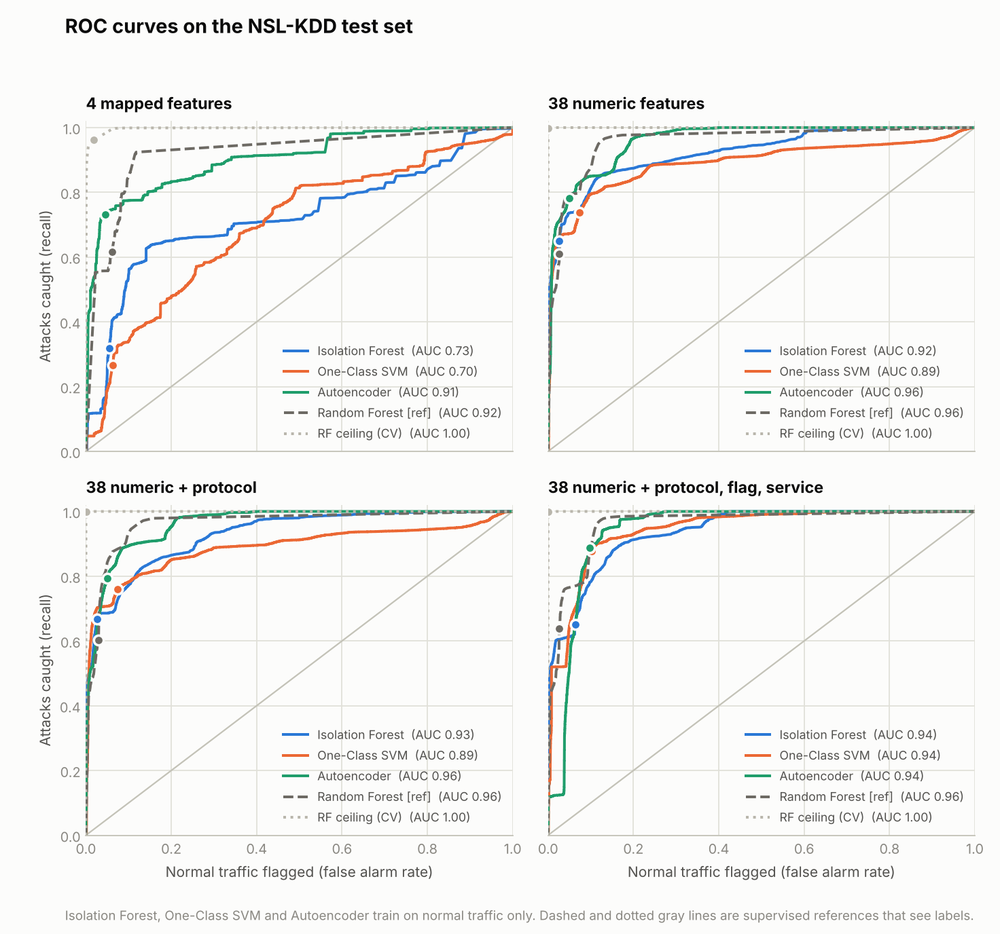

# AI-Driven Log Anomaly Detector

A small machine learning pipeline that learns what normal network/security log activity looks like and flags unusual sessions (long durations, huge packet counts, many failed logins). It uses an Isolation Forest from scikit-learn, with a command line interface for training and analysis. It is evaluated on the NSL-KDD intrusion detection benchmark and compared against a One-Class SVM.

## Project structure

```
ai-log-anomaly-detector/
├── data/
│   ├── malicious_logs.csv      # tiny 7-row sample from the blueprint
│   └── nsl-kdd/                # downloaded by src/download_nsl_kdd.py (not committed)
├── models/                     # trained models are saved here
├── results/
│   ├── nsl_kdd_results.json    # all metrics from the benchmark run
│   └── nsl_kdd_roc.png         # ROC curves
├── web/
│   └── index.html              # single-page front end served by the API
├── src/
│   ├── engine.py               # preprocessing, training, detection
│   ├── app.py                  # command line interface
│   ├── api.py                  # FastAPI service (serves web/index.html)
│   ├── auth.py                 # password hashing, signed sessions, rate limiting
│   ├── users.py                # account storage (Postgres/Neon, SQLite locally)
│   ├── dashboard.py            # Streamlit dashboard
│   ├── pipeline.py             # validation and summaries shared by api + dashboard
│   ├── generate_data.py        # synthetic data generator (normal + attacks)
│   ├── download_nsl_kdd.py     # fetches the NSL-KDD benchmark files
│   └── evaluate.py             # benchmark evaluation and ROC figure
├── tests/                      # pytest suite
├── index.py                    # Vercel entrypoint (exposes the FastAPI app)
├── vercel.json                 # Vercel function settings
├── requirements.txt            # runtime dependencies (CLI + web app)
└── requirements-dev.txt        # adds tests, dashboard, benchmark plotting
```

## Setup

```
pip install -r requirements-dev.txt
```

## Usage

Quick demo on the small sample:

```
python src/app.py --mode train --input data/malicious_logs.csv --contamination 0.3
python src/app.py --mode analyze --input data/malicious_logs.csv
```

Synthetic data demo:

```
python src/generate_data.py --rows 1000 --out data/synthetic_logs.csv
python src/app.py --mode train --input data/synthetic_logs.csv
python src/app.py --mode analyze --input data/synthetic_logs.csv
```

Benchmark evaluation on real data (about 20 seconds):

```
python src/download_nsl_kdd.py
python src/evaluate.py
```

Run the tests:

```
python -m pytest
```

## Web app

A FastAPI service with a small browser front end: upload logs, train, analyze, and see flagged sessions plus the NSL-KDD benchmark.

```
uvicorn api:app --app-dir src --reload
```

Accounts are stored in a local SQLite file by default. For quick local use without signing in, set `AUTH_DISABLED=1` (this also enables the interactive API docs at `/docs`). Otherwise set a signing key first:

```
export AUTH_SECRET=$(python src/auth.py secret)
uvicorn api:app --app-dir src --reload
```

Open http://127.0.0.1:8000, create an account, and click **Run demo** to try it with no files. The header has a light/dark toggle that follows your system setting until you pick one.

### Accounts and security

| Setting | Purpose |
|---|---|
| `AUTH_SECRET` | Required. 32+ random characters that sign session cookies (`python src/auth.py secret`). |
| `DATABASE_URL` | Postgres connection string (for example Neon). Required on Vercel, where the filesystem is wiped between runs. Without it, accounts use a local SQLite file. |
| `SIGNUP_ENABLED=0` | Closes sign-ups. Existing accounts can still sign in. |
| `AUTH_DISABLED=1` | Turns login off. Local development only. |

Passwords are stored only as salted scrypt hashes. Sessions are signed, HttpOnly cookies that last 8 hours. Failed logins and sign-ups are rate limited per client, per server instance (best effort on serverless). If `AUTH_SECRET` is missing the server refuses all access instead of running open. There is no email verification or password reset yet.

| Endpoint | What it does |
|---|---|
| `POST /api/signup`, `/api/login`, `/api/logout` | Create an account, sign in, sign out |
| `GET /api/session` | Current user and their model status |
| `POST /api/train` | Train on an uploaded CSV (`file`, optional `contamination`) |
| `POST /api/analyze` | Score an uploaded CSV with the current model |
| `POST /api/demo` | Generate synthetic traffic with attacks, train, and analyze |
| `GET /api/sample.csv` | Download a synthetic CSV to try uploading |
| `GET /api/benchmark` | NSL-KDD benchmark table |
| `GET /api/health` | Public liveness check |

Every route except sign-up, login, health and the page itself needs a signed-in session. Uploads are limited to 10 MB and 100,000 rows. Each account has its own trained model, saved under `models/`.

### Deploying

The repo deploys to Vercel as-is (`index.py` is the entrypoint and `requirements.txt` holds only the runtime dependencies). Set `AUTH_SECRET` and `DATABASE_URL` as environment variables on the project. On serverless hosts each warm instance keeps trained models in `/tmp`, so after a cold start the app may say no model is trained and you train again. Accounts are not affected, since they live in the database.

## Threat detection and response platform

Beyond the CSV analysis, the web app is an automated detect → investigate → respond pipeline (the **Threat platform** tab).

1. **Ingest.** Ship logs continuously with `python src/tailer.py --url https://YOUR-APP/api/ingest /var/log/auth.log` (set `INGEST_TOKEN`; create tokens in the dashboard), or POST JSON lines, key=value firewall logs or sshd syslog to `/api/ingest` from a webhook or syslog forwarder.
2. **Detect.** Events are grouped into 15-minute windows per source IP and scored by an Isolation Forest on 15 features: packet-size variance, request-timing entropy (beaconing), off-hours activity against the user's own baseline, rare/high ports, foreign destinations, new subnets, failed-login ratio and more.
3. **Investigate.** Each alert goes to an analyst agent with tools: window events, IP reputation (AbuseIPDB / VirusTotal), directory group lookup, and registered-job matching (so a scheduled backup is dismissed as a false positive). With `ANTHROPIC_API_KEY` set it uses Claude through tool use; without it, a deterministic rules investigator does the same job. Output is a structured SOC report (summary, root cause, evidence, timeline, MITRE technique, containment) downloadable as Markdown.
4. **Respond.** Alerts go to your HTTPS webhook (Slack-style). Isolating a host or blocking an IP is never automatic: above the isolate threshold it waits for an analyst's approval, protected hosts are always refused, and every step is recorded. The default connector is a dry run; set `RESPONSE_WEBHOOK_URL` (and `RESPONSE_WEBHOOK_TOKEN`) to call your firewall/EDR.

Safety rules: log content is treated as untrusted text (prompt-injection resistant: the model can only suggest, policy code executes, action targets must come from the incident's own indicators); the agent can't dismiss an alert unless a registered job fully matches or confidence is very high and risk is below the isolate threshold, and never if threat intel says malicious; webhooks are SSRF-guarded.

Environment variables (set in Vercel project settings, never in the repo): `ANTHROPIC_API_KEY`, `AGENT_MODEL`, `AGENT_MAX_PER_HOUR`, `ABUSEIPDB_API_KEY`, `VIRUSTOTAL_API_KEY`, `RESPONSE_WEBHOOK_URL`, `RESPONSE_WEBHOOK_TOKEN`. Without intel keys a built-in demo feed covers the simulator's addresses. Click **Load demo environment** (Settings) to try everything with simulated attacks.

The interface has a public cover page and, after sign-in, a sidebar dashboard: Overview (KPIs, hourly alert and event charts, top sources, MITRE techniques), Incidents (investigation, trace, report), Approvals, Log sources (tokens, live event feed), CSV analysis and Settings.

- **Try it on real logs:** see [docs/REAL_WORLD.md](docs/REAL_WORLD.md). `tools/scenario.py` generates realistic sshd history and a live brute-force attack for the tailer to ship.
- **Desktop app:** `desktop/` is an Electron wrapper around the deployed site (see [desktop/README.md](desktop/README.md)).

## Dashboard

```
streamlit run src/dashboard.py
```

Choose the synthetic demo or upload your own CSVs in the sidebar, then press **Train & analyze**. The Detection tab shows metrics, the risk score distribution with the flagging threshold, and a downloadable table of flagged sessions. The Benchmark tab compares the detectors (Isolation Forest, One-Class SVM, autoencoder, and the supervised Random Forest reference) on NSL-KDD.

## How it works

1. **Features:** by default `duration`, `packet_count`, `byte_size`, `failed_logins`. Missing columns become 0 and unparseable values are treated as 0. The engine accepts any feature list.
2. **Scaling:** features are standardized with `StandardScaler`, fitted on training data only.
3. **Model:** `IsolationForest` isolates unusual points in fewer random splits. `contamination` sets the share of training data treated as anomalous, which fixes the detection threshold.
4. **Output:** each row gets an `anomaly_status` (`NORMAL` or `CRITICAL ANOMALY`) and a `risk_score` from 0 to 100 (higher is more anomalous).

## Evaluation on NSL-KDD

**Protocol.** Each detector is trained only on the 67,343 normal connections in `KDDTrain+`, then scored on `KDDTest+` (22,544 connections: 9,711 normal and 12,833 attacks, including attack types that never appear in training). Labels are used only to measure results, never to train.

**Detectors.**

- Isolation Forest (`contamination=0.05`, trained on all 67,343 normal rows).
- One-Class SVM with an RBF kernel (`nu=0.05`, trained on a random 10,000-row sample of the normal rows because kernel SVMs scale poorly).
- **Autoencoder** (unsupervised, `src/extra_models.py`): a scikit-learn `MLPRegressor` (hidden layers 32-8-32) trained to reconstruct normal rows; reconstruction error is the anomaly score and the threshold is the 95th percentile of training error. Byte-count style columns are log-compressed, then standardized.
- **Random Forest, supervised reference.** Unlike the three above it is trained with attack labels, so it is a reference, not a like-for-like competitor. Two versions: *train to test*, trained on the labeled `KDDTrain+` and scored on `KDDTest+` (same test as the others); and *cross-validated*, 5-fold CV inside `KDDTrain+` only, where every attack type in the held-out fold also appears in training. The second is the optimistic ceiling for "labels for every attack type are available".

**Feature sets.**

- `mapped4`: the pipeline's four features, mapped from NSL-KDD (`duration`; `count` as packet count; `src_bytes + dst_bytes` as byte size; `num_failed_logins`).
- `numeric38`: all 38 numeric NSL-KDD columns.
- `numeric38_protocol`: those plus one-hot protocol (41 features).
- `numeric38_all_cat`: those plus one-hot protocol, flag, and service (122 features).

Categories are taken from the training set only, so categories that appear only in the test set encode as all zeros.

| Detector | Features | Precision | Recall | F1 | ROC AUC |
|---|---|---|---|---|---|
| Isolation Forest | mapped4 | 0.885 | 0.318 | 0.468 | 0.727 |
| Isolation Forest | numeric38 | 0.972 | 0.650 | 0.779 | 0.924 |
| Isolation Forest | numeric38_protocol | 0.971 | 0.668 | 0.791 | 0.929 |
| Isolation Forest | numeric38_all_cat | 0.931 | 0.650 | 0.766 | 0.938 |
| One-Class SVM | mapped4 | 0.847 | 0.267 | 0.406 | 0.697 |
| One-Class SVM | numeric38 | 0.930 | 0.738 | 0.823 | 0.890 |
| One-Class SVM | numeric38_protocol | 0.931 | 0.759 | 0.836 | 0.889 |
| One-Class SVM | numeric38_all_cat | 0.918 | 0.877 | 0.897 | 0.943 |
| Autoencoder | mapped4 | 0.955 | 0.732 | 0.829 | 0.905 |
| Autoencoder | numeric38 | 0.954 | 0.782 | 0.860 | 0.960 |
| Autoencoder | numeric38_protocol | 0.954 | 0.793 | 0.866 | 0.962 |
| Autoencoder | numeric38_all_cat | 0.923 | 0.889 | 0.906 | 0.941 |
| Random Forest, supervised (train to test) | mapped4 | 0.931 | 0.617 | 0.742 | 0.921 |
| Random Forest, supervised (train to test) | numeric38 | 0.968 | 0.609 | 0.748 | 0.958 |
| Random Forest, supervised (train to test) | numeric38_protocol | 0.965 | 0.603 | 0.742 | 0.962 |
| Random Forest, supervised (train to test) | numeric38_all_cat | 0.969 | 0.638 | 0.769 | 0.960 |
| Random Forest, supervised (5-fold CV, ceiling) | mapped4 | 0.979 | 0.962 | 0.971 | 0.997 |
| Random Forest, supervised (5-fold CV, ceiling) | numeric38 | 0.999 | 0.998 | 0.998 | 1.000 |
| Random Forest, supervised (5-fold CV, ceiling) | numeric38_protocol | 0.999 | 0.998 | 0.999 | 1.000 |
| Random Forest, supervised (5-fold CV, ceiling) | numeric38_all_cat | 1.000 | 0.998 | 0.999 | 1.000 |

The CV rows are scored on a different set (`KDDTrain+`, 125,973 rows) than the others (`KDDTest+`), so they are a ceiling, not a head-to-head number.



Recall by attack type with the full feature set (`numeric38_all_cat`), for the most common attacks in the test set:

| Attack | Test count | Isolation Forest | One-Class SVM | Autoencoder | Random Forest (train to test) |
|---|---|---|---|---|---|
| neptune | 4,657 | 1.00 | 1.00 | 1.00 | 1.00 |
| guess_passwd | 1,231 | 0.02 | 0.98 | 0.99 | 0.00 |
| mscan | 996 | 0.96 | 0.95 | 0.95 | 0.35 |
| warezmaster | 944 | 0.06 | 0.54 | 0.79 | 0.16 |
| apache2 | 737 | 0.93 | 1.00 | 1.00 | 0.70 |
| satan | 735 | 0.98 | 0.99 | 0.94 | 1.00 |
| processtable | 685 | 0.38 | 0.84 | 1.00 | 0.01 |
| smurf | 665 | 0.36 | 1.00 | 1.00 | 1.00 |

**Reading the results**

- The four-feature version misses most attacks for both detectors (recall under 0.35, ROC AUC about 0.70). Those four columns alone are not enough for this dataset.
- Using all 38 numeric features is the biggest improvement (Isolation Forest ROC AUC 0.73 to 0.92). Adding protocol helps a little, and adding flag and service helps a little more for Isolation Forest.
- On the numeric-only feature sets, Isolation Forest ranks traffic better than the One-Class SVM (ROC AUC 0.92 vs 0.89). With flag and service added, the two are about tied (0.938 vs 0.943), a gap too small to read much into from a single run.
- The One-Class SVM's recall jump with the full feature set, especially on guess_passwd (0.98 vs 0.02), probably comes from service rarity rather than from detecting password guessing. 750 of the 1,231 guess_passwd test rows use the `pop_3` service, which is only 0.28% of normal training traffic. A detector can flag those rows simply because the service is unusual. This was not isolated further.
- The recall gains come with more false alarms. With the full feature set the One-Class SVM flags 999 of 9,711 normal connections (10.3%) and Isolation Forest flags 620 (6.4%). Because the two detectors sit at different thresholds, compare ROC AUC (which ignores the threshold) rather than precision or recall.
- Both detectors do well on flood and scan style attacks (neptune, satan, mscan, apache2) and poorly on attacks that look like ordinary sessions in these statistics, such as warezmaster.
- NSL-KDD's test set is 57% attacks, far more than real traffic, so precision here would be much lower on a realistic mix. Recall and ROC AUC are the more transferable numbers.
- **Autoencoder.** It is the best unsupervised detector here on the feature sets without flag/service (F1 0.86 and ROC AUC 0.96 on `numeric38`, versus 0.78 and 0.92 for Isolation Forest), and it lifts even the four-feature set to ROC AUC 0.905. With the full 122 features it is about tied with the One-Class SVM (ROC AUC 0.941 vs 0.943). On `numeric38_all_cat` it flags 949 of 9,711 normal rows (9.8%), so its higher recall also costs false alarms. It was not tuned; architecture and threshold are first guesses.
- **Supervised reference.** On the same train-to-test split the Random Forest does not beat the unsupervised detectors on F1 (0.74 to 0.77 vs up to 0.91). It ranks traffic well (ROC AUC about 0.96) with few false alarms (258 of 9,711 normal rows flagged), but it misses attack types it was not shown: guess_passwd recall 0.00, processtable 0.01. `KDDTest+` contains attack types absent from `KDDTrain+`, which is where a supervised model is weakest. When every attack type is represented in training (the 5-fold CV rows) it reaches F1 about 0.999. That is the ceiling, and it also shows `KDDTrain+` alone is easy to fit; it does not say how a labeled model would do on future unseen attacks.
- Results come from one run with a fixed random seed. Variation across seeds was not measured, and the One-Class SVM was trained on a 10,000-row subsample while Isolation Forest used all normal rows.

Dataset: Tavallaee, Bagheri, Lu, Ghorbani, "A Detailed Analysis of the KDD CUP 99 Data Set", IEEE CISDA 2009 (Canadian Institute for Cybersecurity, University of New Brunswick). The download script fetches it from a public GitHub mirror.

## Other notes

- With only 7 rows, the default `contamination=0.05` flags just one of the two attack rows in the sample. Setting `--contamination 0.3` flags both.
- The synthetic data is generated, so it only shows that the pipeline works.

## Ideas for next steps

- Repeat the evaluation over several random seeds and report the spread.
- Test whether the service effect is real: evaluate with and without the rare-service rows, or hold out entire services.
- Add a supervised baseline (for example a random forest) as a reference ceiling, and try an autoencoder detector.
- Add email verification and password reset for accounts.
